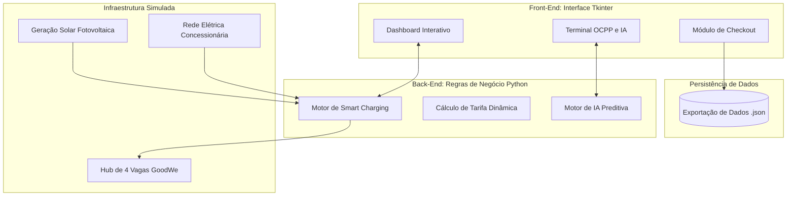

# ⚡ REECHARGE - Sistema Inteligente de Gestão de Recarga para Veículos Elétricos

## 👥 Equipe
- **Enzo Posterlli Strinta** - RM570035
- **Giovanna Tristão Lopes** - RM572552

---

## 📖 Sobre o Projeto
O **REECHARGE** é uma plataforma simulada de gerenciamento de estações de recarga para Veículos Elétricos (VEs) com foco comercial. A solução integra automação de distribuição de energia (*Smart Charging*), sinergia com geração fotovoltaica (painéis solares), precificação dinâmica e insights gerados por Inteligência Artificial, tudo através de uma interface gráfica intuitiva e profissional desenvolvida em Python.

---

## 🧩 Esquema Detalhado de Integração dos Componentes

### 1. Diagrama de Blocos da Arquitetura (Hardware & Software)

---
### 2. Fluxograma de Operação do Usuário

```mermaid
flowchart LR
    A([Início]) --> B[Monitoramento: Grid + Solar]
    B --> C{O que fazer?}
    
    C -- "Conectar" --> D[Definir Bateria]
    D --> E[Simular Recarga]
    E --> F{Fim da Carga?}
    F -- "Não" --> E
    F -- "Sim" --> G[Módulo Pagamento]
    
    C -- "Sistema" --> L[Acionar IA / Tempo]
    L --> B
    
    G --> H[PIX ou Cartão]
    H --> I[Gerar Relatório JSON]
    I --> J([Liberar Vaga])
    J -. "Retorna ao início" .-> B
````
---

### 3. Protótipo Simulado

* **Tela Inicial**


* **Simulação de Pagamento**


---

## 🛠 Justificativa Técnica das Escolhas
Para atender aos requisitos de automação e integração técnica de forma otimizada e acessível, adotamos as seguintes tecnologias:

* **Linguagem (Python):** Escolhida por sua versatilidade e facilidade na manipulação de estruturas de dados e criação de lógicas complexas de automação.

* **Interface Gráfica (Tkinter):** Utilizamos uma biblioteca nativa do Python. Isso justifica-se para garantir que o software rode em qualquer ambiente sem necessidade de instalações complexas via pip, mantendo o código leve e focado no Pensamento Computacional.

* **Comunicação (Padrão OCPP 1.6J):** O sistema simula mensagens desse protocolo aberto, pois é o padrão global adotado pela indústria (vendors como a GoodWe). Isso torna a lógica de negócio do software compatível com a realidade do mercado.

* **Armazenamento de Dados (JSON):** A persistência de dados de faturamento no formato JSON é o formato universal de troca de informações moderno, facilitando integrações futuras com APIs, bancos de dados NoSQL e Web Dashboards.

* **Design Visual (Preto e Vermelho):** Adotado para conferir um aspecto profissional, tecnológico e de fácil leitura (Dark Mode).
---

## 🌱 Contribuição para Sustentabilidade, Automação Inteligente e Eficiência Energética

O projeto foi arquitetado para que cada tecnologia aplicada atue diretamente nos três pilares exigidos para a infraestrutura moderna de cidades inteligentes:

### 1. Sustentabilidade (Integração Fotovoltaica Simulada)
* **Tecnologia:** Lógica de injeção de energia renovável baseada em horário (Simulação de Inversores Híbridos).
* **Contribuição:** O sistema reduz a dependência de combustíveis fósseis e da rede elétrica convencional ao priorizar a energia solar. Ao detectar alta geração (ex: entre 10h e 14h), a plataforma orienta o consumo de energia limpa, reduzindo a pegada de carbono da operação do hub de recarga.

### 2. Automação Inteligente (Motor Python e IA Preditiva)
* **Tecnologia:** Algoritmos em Python e Processamento de Regras Preditivas.
* **Contribuição:** O sistema elimina a necessidade de microgerenciamento humano. A automação inteligente monitora em tempo real a ocupação das vagas, a tarifa do momento (Demand Response) e a geração solar. Além disso, o Agente de IA toma decisões de negócio de forma autônoma, sugerindo ao operador aplicar tarifas promocionais ou alertando sobre sobrecargas iminentes antes que elas afetem a infraestrutura.

### 3. Eficiência Energética (Smart Charging e OCPP 1.6J)
* **Tecnologia:** Algoritmo de *Load Balancing* (Balanceamento de Carga) e mensagens do padrão OCPP.
* **Contribuição:** A eficiência energética é garantida pelo *Smart Charging*. Em vez de sobrecarregar a rede ou precisar de cabos e transformadores superdimensionados (o que seria caro e ineficiente), o algoritmo divide dinamicamente a potência exata disponível (Rede + Solar) entre os veículos conectados. Isso garante que nenhum watt seja desperdiçado e que o limite contratado da distribuidora de energia nunca seja estourado, garantindo máxima eficiência com os recursos físicos disponíveis.
---

## ⚙️ Dinâmica da Automação (Motor de Simulação)

Para atender ao conceito de **Automação** em Python, substituímos ações manuais de simulação por um **Loop de Eventos Assíncronos** (usando `tkinter.after`).

- **Avanço do Tempo:** A cada 1,5 segundos da vida real, o sistema avança 15 minutos na simulação.
- **Cálculo Solar:** A geração de energia fotovoltaica (kW) é calculada de forma estática **uma vez por hora** na virada do relógio (e não mais de forma volátil a cada recarga).
- **Recarga Fluída:** Os veículos recebem frações de energia (kWh) de maneira ininterrupta em segundo plano, respeitando os limites da rede (Smart Charging) e acionando o limite máximo automaticamente caso a demanda supere o *Grid + Solar*.

---

## 📊 Resultados Reais da Simulação (Exemplo Prático)

Durante a execução da nossa aplicação, geramos o comportamento natural de uma estação e exportamos o resultado financeiro de faturamento. Abaixo está a comprovação gerada (extraída da exportação em `.json`), mostrando como os dados operam de ponta a ponta:

```json
[
    {
        "vaga": "1",
        "energia_kwh": 37.25,
        "total_rs": 29.8,
        "pagamento": "PIX",
        "tarifa_aplicada": 0.8,
        "data": "2026-10-13 14:15:22"
    },
    {
        "vaga": "2",
        "energia_kwh": 40.0,
        "total_rs": 41.6,
        "pagamento": "Cartão de Crédito",
        "tarifa_aplicada": 1.04,
        "data": "2026-10-13 19:30:10"
    }
]
--- 

## 🧠 Conexão com os Conteúdos da Disciplina
Este projeto engloba de forma prática os pilares da disciplina de Pensamento Computacional e Automação com Python:

* **Decomposição:** O problema de gestão de frota foi quebrado em módulos menores (Cálculo de Tarifa, IA Preditiva, Interface Visual, Simulador OCPP).

* **Reconhecimento de Padrões e Algoritmos:** A lógica de Smart Charging é um algoritmo clássico de balanceamento de carga, distribuindo recursos (potência) com base em variáveis dinâmicas (carros ativos vs energia total).

* **Automação:** O sistema automatiza o faturamento baseado em horário comercial e a aplicação de energia solar na equação de disponibilidade da rede.

* **Programação Orientada a Objetos (POO):** O código GUI foi encapsulado na classe ReechargeGUI, gerindo os estados das variáveis globais do hub de recarga de maneira limpa.
---

## ⚙️ Estrutura do Repositório e Instruções de Funcionamento
### Arquivos no Repositório:
* codigo: Código-fonte principal com a Interface Gráfica e regras de negócio.

* readme.md: Documentação atual do projeto.

### Como Executar a Aplicação:
1. Certifique-se de ter o Python 3.8 ou superior instalado em sua máquina.

2. Clone o repositório ou faça o download do arquivo codigo.py.

3. Abra o terminal na pasta onde o arquivo está salvo.

4. Interaja com a interface gráfica, crie sessões, teste o módulo de pagamento e verifique o arquivo .json gerado ao final das operações na mesma pasta do executável.
