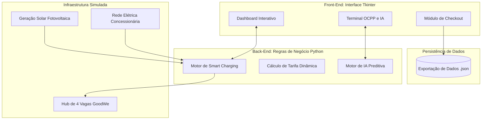

# ⚡ REECHARGE - Sistema Inteligente de Gestão de Recarga para Veículos Elétricos

## 👥 Equipe
- **Enzo Posterlli Strinta** - RM570035
- **Giovanna Tristão Lopes** - RM572552

---

## 📖 Sobre o Projeto
O **REECHARGE** é uma plataforma simulada de gerenciamento de estações de recarga para Veículos Elétricos (VEs) com foco comercial. A solução integra automação de distribuição de energia (*Smart Charging*), sinergia com geração fotovoltaica (painéis solares), precificação dinâmica e insights gerados por Inteligência Artificial, tudo através de uma interface gráfica intuitiva e profissional desenvolvida em Python.

---

## 🎯 Alinhamento ao Desafio GoodWe e Resolução de Pontos-Chave

O desafio da GoodWe aborda a ausência de mecanismos integrados em eletropostos comerciais para gerenciar a potência, registrar o ciclo da sessão e aplicar políticas de tarifação. Nossa plataforma atua como o "cérebro" do eletroposto, orquestrando esses exatos pontos:

1. **Gestão de Potência (Smart Charging contra Multas):**
   * *O Problema:* Picos de demanda geram multas contratuais pesadas junto às concessionárias de energia.
   * *A Solução:* O sistema monitora a potência limite da rede somada à geração solar instantânea. Se a demanda dos veículos ultrapassar esse limite, a automação aplica um *Rate-Limiting* (corte proporcional de potência entregue), protegendo a rede do estabelecimento de sobrecargas e multas tarifárias.

2. **Registro do Ciclo da Sessão (Automação OCPP & MODBUS):**
   * *O Problema:* Falta de rastreabilidade física e de software das recargas.
   * *A Solução:* A plataforma simula a leitura de sensores de inversores solares via protocolo MODBUS e orquestra as trocas de mensagens via protocolo OCPP 1.6J (*StartTransaction, MeterValues, StopTransaction*), garantindo que cada kWh injetado e consumido seja auditado e registrado.

3. **Políticas de Tarifação e Pagamento Dinâmico:**
   * *O Problema:* Modelos de cobrança estáticos não acompanham as flutuações de custo da energia elétrica (horário de pico).
   * *A Solução:* O motor de tarifação monitora o relógio e aplica um conceito de *Demand Response*, adicionando um prêmio (acréscimo de 30%) em horários de pico (18h-21h). O módulo de pagamento integrado no sistema finaliza a operação simulando gateways de PIX e Cartão de Crédito.
   * 
---

## 🧩 Esquema Detalhado de Integração dos Componentes

### 1. Diagrama de Blocos da Arquitetura (Hardware & Software)

---
### 2. Fluxograma de Operação do Usuário

```mermaid
flowchart LR
    A([Início]) --> B[Monitoramento: Grid + Solar]
    B --> C{O que fazer?}
    
    C -- "Conectar" --> D[Definir Bateria]
    D --> E[Simular Recarga]
    E --> F{Fim da Carga?}
    F -- "Não" --> E
    F -- "Sim" --> G[Módulo Pagamento]
    
    C -- "Sistema" --> L[Acionar IA / Tempo]
    L --> B
    
    G --> H[PIX ou Cartão]
    H --> I[Gerar Relatório JSON]
    I --> J([Liberar Vaga])
    J -. "Retorna ao início" .-> B
````
---

### 3. Protótipo Simulado

* **Tela Inicial**


* **Simulação de Pagamento**


---

## 🛠 Justificativa Técnica das Escolhas
Para atender aos requisitos de automação e integração técnica, adotamos as seguintes tecnologias:

* **Linguagem (Python):** Escolhida por sua versatilidade e facilidade na manipulação de estruturas de dados e criação de lógicas complexas de automação.

* **Interface Gráfica (Tkinter):** Utilizamos uma biblioteca nativa do Python. Isso justifica-se para garantir que o software rode em qualquer ambiente sem necessidade de instalações complexas via pip, mantendo o código leve e focado no Pensamento Computacional.

* **Protocolos e Sensores Abstraídos:** 
  * **OCPP 1.6J:** O sistema simula mensagens desse protocolo aberto, pois é o padrão global adotado por fabricantes como a GoodWe para comunicação V2G (Vehicle-to-Grid) e infraestrutura.
  * **MODBUS / Sensores de Irradiação:** A captação de energia solar é simulada espelhando o comportamento de sensores de irradiação solar lidos por inversores híbridos via protocolo industrial MODBUS.

* **Armazenamento de Dados (JSON):** A persistência de dados de faturamento no formato JSON é o formato universal de troca de informações moderno, facilitando integrações futuras com APIs, bancos de dados NoSQL e Web Dashboards.

---

## 🌱 Avaliação Crítica: Sustentabilidade, Inovação e Eficiência

### 1. Sustentabilidade e ESG
* **Tecnologia:** Simulação de integração com Inversores Híbridos baseada em horário.
* **Avaliação:** O projeto desvia de ser apenas um "ponto de tomada". Ele prioriza e maximiza ativamente a injeção de energia renovável na frota. Reduzimos a pegada de carbono ao detectar excedente de sol e direcionar esse recurso limpo para carregar os veículos, desonerando usinas não renováveis em horários de pico.

### 2. Automação Inteligente e Inovação
* **Tecnologia:** Loop Assíncrono (tkinter.after) e Agente de IA Preditiva baseada em heurística.
* **Avaliação:** A verdadeira inovação da plataforma é transformar o hardware de carregamento em um dispositivo de borda (Edge Computing). O Agente de IA toma decisões de negócio de forma autônoma, gerando alertas preditivos de saturação antes que falhas elétricas ocorram. A automação invisível elimina o microgerenciamento humano.

### 3. Eficiência Energética (Smart Charging)
* **Tecnologia:** Algoritmo de Balanceamento de Carga (Load Balancing).
* **Avaliação:** O sistema prova que não é necessário investir centenas de milhares de reais em novos cabos e transformadores para instalar eletropostos comerciais. O algoritmo de Smart Charging fatia dinamicamente a potência disponível (Rede + Solar), otimizando a infraestrutura elétrica já existente até o limite máximo de sua eficiência, sem desperdícios.

---

## ⚙️ Dinâmica da Automação (Motor de Simulação)

A cada 1,5 segundos da vida real, o sistema avança 15 minutos na simulação.

- **Avanço do Tempo:** A cada 1,5 segundos da vida real, o sistema avança 15 minutos na simulação.
- **Cálculo Solar:** A geração fotovoltaica é reavaliada apenas uma vez por hora na virada do relógio simulado, trazendo fidelidade ao comportamento do sol.
- **Recarga Fluída:** Os veículos recebem frações de energia (kWh) de forma contínua em background, acionando limitadores automaticamente se a demanda superar o Grid + Solar.

---

## 📊 Resultados Obtidos

### 1. Resultados Qualitativos
* **Interface Corporativa:** A adoção do padrão Dark Mode permitiu visualizar e operar as regras de negócio em um ambiente consolidado e livre de poluição visual.
* **Alertas em Linguagem Natural:** O motor de IA traduz os dados brutos de energia em informações acionáveis e humanizadas para o operador (ex: "Aproveite o pico de sol").
* **Fluidez Sistêmica:** A substituição de atualizações baseadas em cliques por uma automação guiada pelo tempo real aproximou o projeto de um software IoT comercial.
* 
### 1. Resultados Quantitativos
O sistema loga e exporta as transações para um arquivo .json gerado ao final. Abaixo a demonstração de ponta a ponta gerada pela automação:

```json
[
    {
        "vaga": "1",
        "energia_kwh": 37.25,
        "total_rs": 29.8,
        "pagamento": "PIX",
        "tarifa_aplicada": 0.8,
        "data": "2026-10-13 14:15:22"
    },
    {
        "vaga": "2",
        "energia_kwh": 40.0,
        "total_rs": 41.6,
        "pagamento": "Cartão de Crédito",
        "tarifa_aplicada": 1.04,
        "data": "2026-10-13 19:30:10"
    }
]
```

> Nota-se claramente a ação das regras de negócio: A Vaga 2 conectou no horário de pico noturno e sofreu o repasse do custo da rede estressada (R$ 1,04/kWh), enquanto a Vaga 1 usufruiu da geração solar e pagou a taxa comum (R$ 0,80/kWh). 
--- 

## 🧠 Conexão com os Conteúdos da Disciplina
Este projeto engloba de forma prática os pilares da disciplina de Pensamento Computacional e Automação com Python:

* **Decomposição:** O problema central foi quebrado em módulos menores (Tarifação, Interface, Inteligência Artificial, Protocolos).

* **Reconhecimento de Padrões:** A lógica de Smart Charging distribui recursos com base em variáveis dinâmicas (carros ativos vs energia total).

* **Automação:** O sistema avança o faturamento e aplica condições climáticas na rede em segundo plano.

---

## ⚙️ Estrutura do Repositório e Instruções de Funcionamento
### Arquivos no Repositório:
* codigo.py: Código-fonte principal com a Interface Gráfica e automações.

* readme.md: Documentação técnica do projeto.

### Como Executar a Aplicação:
1. Certifique-se de ter o Python 3.8 ou superior instalado em sua máquina.

2. Clone o repositório ou faça o download do arquivo codigo.py.

3. Abra o terminal na pasta correspondente e execute codigo.py.

4. Clique em "Iniciar Automação" na interface, crie sessões, realize simulações de pagamento e confira o relatório .json persistido no seu diretório
